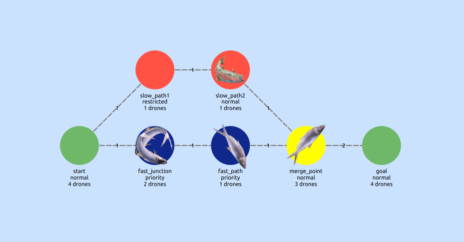
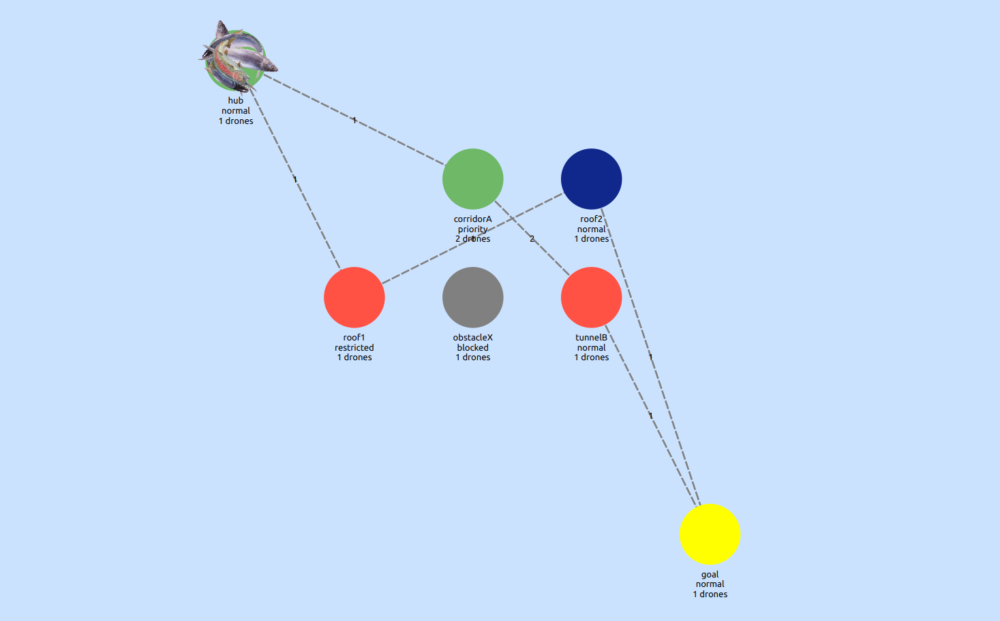

*This project has been created as part of the 42 curriculum by jvacossi.*

# Fly-in


## Description
Fly-in is an **efficient drone routing system** that navigates **multiple drones**
through **connected zones** while minimizing **simulation turns** and handling **movement constraints**.

This project efficiently route a fleet of drones from a **central base (start)** to a **target location (end)** while navigating this dynamic network under a set of strict constraints and optimization goals.

The drones are routed on **graphes** representing the network of zones and a set of constraints.
The graph is represented as a **network of connected zones**, where connections define possible movement paths between zones.

### The Constraints
The constraints are represented by different zones types:
- **Normal zone**: Default and standard zone with 1 turn movement cost.
- **Priority zone**: A preferred zone. Movement to this zone costs 1 turn but should be prioritized in pathfinding.
- **Restricted zone**: A sensitive or dangerous zone. Movement to this zone costs 2 turns.
- **Blocked zone**: Inaccessible zone. Drones must not enter or pass through this zone. Any path using it is invalid.


Each zones can have metadatas:
- **zone=\<type\>**: to specify the type of the zone. By default it's normal.
- **max_drones=\<number\>**: Maximum drones that can occupy this zone simultaneously. By default it's 1.
- **color=\<value\>**: The color of the zone. Not a real constraint, just usefull for the visualisation.

The connections in-between zones can also have metadatas:
- **max_link_capacity=\<number\>**: Maximum drones that can traverse this connection simultaneously. By default it's 1.

### The Map/Graph
Here is a **example** of a graph that represent the network of zones:
```
nb_drones: 5

start_hub: hub 0 0 [color=green]
end_hub: goal 4 4 [color=yellow]
hub: roof1 1 2 [zone=restricted color=red]
hub: roof2 3 1 [zone=normal color=blue]
hub: corridorA 2 1 [zone=priority color=green max_drones=2]
hub: tunnelB 3 2 [zone=normal color=red]
hub: obstacleX 2 2 [zone=blocked color=gray]

connection: hub-roof1
connection: hub-corridorA
connection: roof1-roof2
connection: roof2-goal
connection: corridorA-tunnelB [max_link_capacity=2]
connection: tunnelB-goal
```

Wich will give:


## Instruction
section containing any relevant information about compilation, installation and execution

## Algorithm
detailed description of the algorithm and implementation strategy

## Visual Representation
documentation of the visual representation features and how they enhance the user experience

## Resources
### Pathfinding algorithm
- https://www.redblobgames.com/pathfinding/a-star/introduction.html
- https://ojs.aaai.org/index.php/AIIDE/article/view/18726/18503
- https://fr.wikipedia.org/wiki/Distance_de_Manhattan
- https://tracker.pathfinding.ai/ (Benchmark for MAPF Algo)
- https://github.com/Jiaoyang-Li/CBSH2-RTC (one of the best MAPF algo)

### Graphical User Interface
- https://www.pythonguis.com
- https://doc.qt.io/qtforpython-6/index.html

### Miscellaneous
- https://fr.wikipedia.org/wiki/PSPACE

## Workflow:
- Parser/MapLoad
- Creation of the Graph
- GUI with the visualisation of the Graph
- Pathfinding Algorithm
	- BFS -> Dijkstra (heuristic function for A*)
	- A* space/time
- GUI animation and UX
